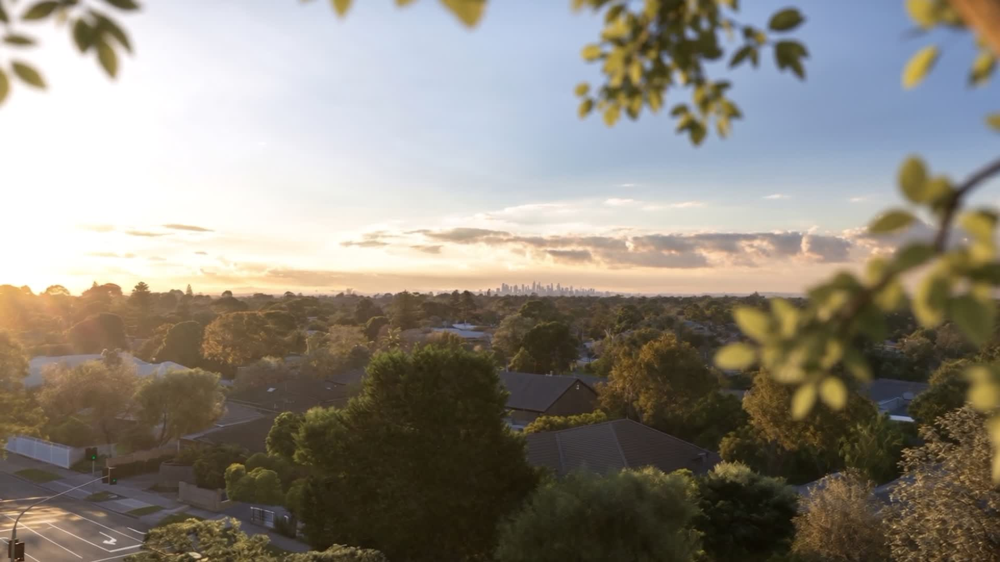

# Parrow’s Signature — Luxury Interior Design & Architecture

> **Spaces | Renovations | Furnishing**  
> Bespoke interior architecture, turnkey renovation, and curated luxury furnishing studio based in Airport Residential Area, Accra, Ghana.



---

## 🌟 Overview

**Parrow’s Signature** is an immersive, high-fidelity luxury digital experience inspired by world-class architectural editorial design (GSAP SmoothScroll, responsive canvas interactive enclaves, video hero intro-to-ambient transitions, and noble material showcases).

### Key Features
- **Hero Video Experience**: Seamless desktop/mobile intro-to-ambient video choreography.
- **Interactive Enclaves Map**: Studio locations and Accra precincts (Airport Residential Area, Cantonments, East Legon, Ridge) interactive mapping.
- **Artisanal Finishes Ping-Pong Swapper**: Stone, American walnut joinery, and architectural tiling with instant cross-dissolve.
- **Bespoke Lookbook & Consultation Flow**: Interactive inquiry modal with direct statutory consent.
- **Available Pieces Furniture Display**: High-res furniture showcase with multi-angle perspective and finish selection.
- **Legal Compliance Suite**: Privacy policy, statutory terms of service, and cookie preferences (Ghana Act 843 & GDPR compliant).

---

## 🛠 Tech Stack

- **Core**: Vanilla HTML5, CSS3, JavaScript (ES Modules).
- **Motion & Smooth Scrolling**: GSAP 3 (ScrollTrigger, SplitText, ScrollSmoother).
- **Typography**: Cormorant Garamond (display serif) & Jost / DM Sans (technical sans).
- **Brand Palette**:
  - Dark Grey: `#2E2E2E` / `#161514`
  - Off-White: `#F7F7F5`
  - Walnut: `#8B5E3C` (accent)

---

## 🚀 Local Setup & Preview

Run a local server in the project directory:

```bash
# Using Python
python -m http.server 8088

# Or using Node.js / npx
npx serve .
```

Open `http://localhost:8088` in your browser.

---

## 📁 Repository Structure

```
├── index.html            # Main architectural experience (Parrow's Signature)
├── furniture.html        # Interactive furniture showcase
├── admin.html            # Secure studio inventory curation portal
├── styles.css            # Architectural layout & design tokens
├── map.css               # Interactive precinct & map styles
├── loam-script.js        # Core interaction & hero choreography
├── editorial.js          # GSAP smooth scrolling & chapter choreography
├── map.js                # Interactive Accra enclaves map engine
├── assets/               # Photography, 4K/1080p hero videos, floorplans, monograms
└── README.md
```

---

## ⚖️ License & Rights

© 2026 Parrow’s Signature. All rights reserved. Crafted for private clients across Greater Accra, Ghana.
